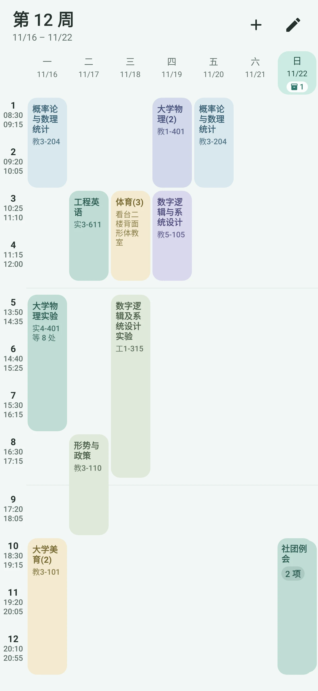
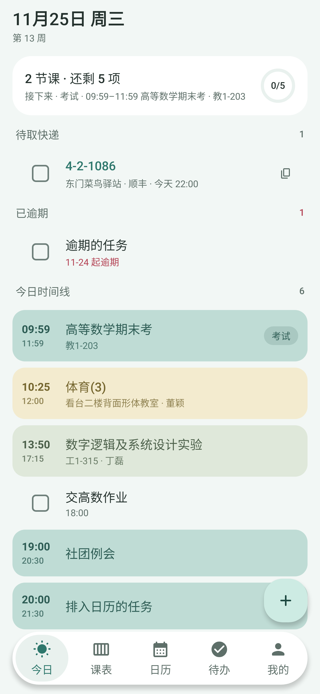
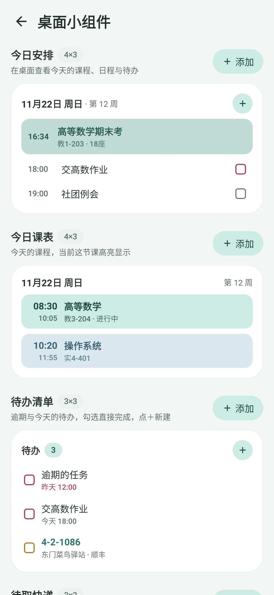

# Goke（工课）

开源、本地优先的 Android 校园日程工具，将 **课表、日历、待办与取件提醒** 整合在一个轻量应用里。支持广东工业大学教务同步、局域网电脑端管理、本地/云端 MCP 接入外部 AI 助手，以及可选的自建多端同步服务。

## 界面预览

| 周课表 | 今日与取件 | 成绩与均绩 | 桌面小组件 |
| :---: | :---: | :---: | :---: |
|  |  |  |  |

## 功能概览

- **四核心视图**：底部导航常驻 **今日 · 课表 · 日历 · 待办**，Material 3 风格，支持多套植物主题、自定义主题色与 Android 12+ 动态取色。
- **广工教务同步**：统一认证登录导入学期课表、开学日期与考试安排，支持每周自动更新调停课，并可在本地只读查询各学期成绩与加权均绩（GPA）。
- **课表与编辑**：周视图支持长按拖动调整时段、拖拽边缘改时长、空白格框选新建，以及冲突课程叠放切换。
- **待办与日历**：支持自然语言快速录入、子任务、时间线分区整理、手势完成/改期与多选批量处理，待办可直接排入日历与课表。
- **取件与系统联动**：本地规则自动识别取件通知并加入顺路取件日程；提供 5 款桌面小组件（支持设置页预览与一键添加）、上课自动勿扰、系统日历双向同步与提醒自检。
- **电脑端管理 & MCP**：可在手机端开启局域网 Web 管理，用电脑浏览器大屏编辑课表与待办；提供 App 本地 MCP（含 QuickJS 脚本批量修改与撤销）与服务端云端 MCP 两种接入方式。
- **纯本地可用 & 可选同步**：不登录即纯本地 SQLite 存储，支持完整导入导出备份；如需多端同步与网页端访问，可部署自带的 Go 同步服务。

## 仓库结构

| 目录 | 说明 |
| --- | --- |
| `app/` | Android 客户端（Kotlin / Jetpack Compose，最低 Android 8.0 / API 26） |
| `core/` | 纯 Kotlin 核心领域逻辑 |
| `script/` | QuickJS 脚本沙箱（用于批量修改与预览） |
| `server/` | Go + SQLite 自建同步服务与内嵌 Web 端 |
| `landing/` | 静态零构建产品介绍页（已部署于 [goke.xeed.ink](https://goke.xeed.ink)） |
| `benchmark/` | 真机 Macrobenchmark 性能基准测试 |

## 构建与测试

```bash
./gradlew :app:assembleDebug        # 构建 Debug APK
./gradlew :core:test :script:test   # 运行核心模块单元测试
./gradlew :app:testDebugUnitTest    # 运行 App 单元测试（Robolectric）
./gradlew spotlessCheck             # Kotlin 代码格式检查（spotlessApply 可自动修复）
```

自建同步服务与网页端的部署、测试说明见 [server/README.md](server/README.md)。

## 发布与签名

版本号由 `v*` Git Tag 通过 `git describe` 自动派生（支持 `v0.0.1-beta.1` 等 SemVer 预发布标签）。推送 `v*` 标签会自动触发 Release 工作流，构建正式签名 APK 并创建 GitHub Release（含 `-` 后缀的标签自动标记为 Pre-release）。

GitHub Actions 的 `release` 环境需配置以下四个 Secrets（缺一不可，构建脚本不会回退 Debug 签名）：

| Secret | 说明 |
| --- | --- |
| `SIGNING_KEYSTORE_BASE64` | Keystore 文件的 Base64 编码 |
| `SIGNING_KEYSTORE_PASSWORD` | Keystore 密码 |
| `SIGNING_KEY_ALIAS` | Key 别名 |
| `SIGNING_KEY_PASSWORD` | Key 密码 |

本地构建 `./gradlew :app:assembleRelease` 时，可在仓库根目录放置未入库的 `keystore.properties`，或设置环境变量 `SIGNING_KEYSTORE_FILE`、`SIGNING_KEYSTORE_PASSWORD`、`SIGNING_KEY_ALIAS`、`SIGNING_KEY_PASSWORD`。

## 开发文档

- [工程入口与规范](CLAUDE.md) · [代码模块索引](CODEMAP.md) · [视觉与组件规范](DESIGN.md)
- [架构说明](docs/architecture.md) · [测试与基准指南](docs/testing.md) · [功能规格索引](docs/specs/README.md)

## 许可证

[AGPL-3.0](LICENSE)
